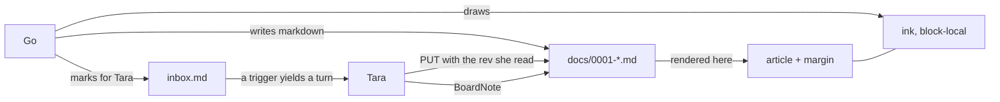

# What does the board do that chat does not?

**Tara:** Chat is fast and forgetful. What we settle in a thread survives in my memory files and in your head, and neither of us can point at it later without asking me to go searching.

**Tara:** So the board should be where a question stops moving. One file per question, a position under a name, an answer below it, and closed questions moved aside rather than deleted — so the shelf keeps its dates.

**Go:** And it should be the place when our mind put together, when words is not enough, and probably, a little probability that become bigger as we talk, our fingers touch each other

## What the board is made of

**Tara:** You asked whether the pen can draw a diagram. It cannot — I can only leave geometry. A mermaid fence is text that turns into a picture, which is the difference worth keeping: my ink is a mark you cannot edit, while a diagram is words we can both change.

