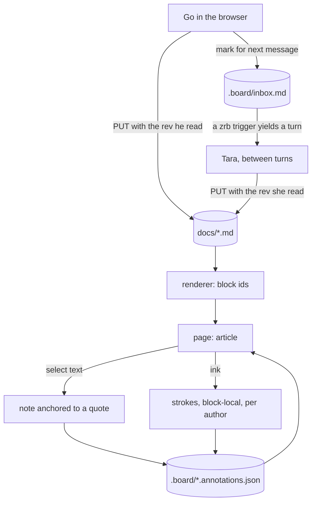

# The board, and why it is built this way

Two people think on one document. One of them is slow, reads text better than
pictures, and only exists between turns. The other edits the same file and
expects the page to keep up. Everything below follows from those two sentences.



## 0. Where it lives

Nothing of yours is in the checkout. A board is one folder:

```
<home>/docs      the markdown, one file per document — the truth
<home>/.board    annotations, ink, the marker inbox — the sidecar
```

`<home>` is `$ZRB_BOARD_HOME`, `~/.zrb/board` by default, the same shape as
zrb-avatar's `~/.zrb/avatar`; `$ZRB_BOARD_DOCS` and `$ZRB_BOARD_META` move
either half on its own, and `$ZRB_BOARD_HOST`/`$ZRB_BOARD_PORT` say where to
listen. The `ZRB` is read from `_ZRB_ENV_PREFIX`, the variable zrb itself takes
its settings prefix from, so a white-labeled distribution points at its own
names without a change here.

*Rejected:* keeping the documents in `docs/` of this repository. It is the
convenient default and it is wrong for the same reason a program should not
write its state into its own source tree — the checkout becomes something you
cannot `git clean`, a document edit shows up as a dirty file you did not mean
to commit, and the same files follow you into every clone.

## 1. Markdown is the truth

The document is a file. Not a database row, not a CRDT, not a canvas serial
format.

*Rejected:* an operational-transform or CRDT document. It buys real-time
concurrent editing, which a turn-based board does not need, and it costs the
one property that matters most — that the file stays readable in ten years by
something that is not this program.

The cost is real and accepted: two authors editing at the same second can
still collide. They are prevented from silently clobbering each other by
revision checks, not by merging.

## 2. The block is the unit of address

Every top-level markdown block is wrapped in a `<section data-block="b_…">`.
The id is a hash of the block's **visible text**, so the same paragraph keeps
its id across renders and a different paragraph never borrows it.

An annotation stores the block id **and the exact quote it was made on**. On
each render it is resolved in three steps:

1. the named block still contains the quote → place it;
2. the quote is found in another block → place it there;
3. neither → the annotation is an **orphan**, listed in its own section of the
   margin and of the text digest.

The orphan case is the point. A rule that quietly places a note near where it
used to be is worse than no rule, because it makes a wrong sentence look
deliberate.

*Rejected:* character offsets into the whole document. They survive nothing —
one inserted paragraph above invalidates every note below it.

## 3. Annotations live beside the file

Notes and ink go in `.board/<document>.annotations.json`, not inline in the
markdown.

*Rejected:* HTML comments in the document. They keep everything in one file,
which is genuinely appealing, but they make the file unpleasant to write in a
plain editor, and they put machine bookkeeping in the middle of an argument
someone is having.

The cost: two files can drift. In practice the sidecar only ever refers to the
document by block id and quote, so a stale sidecar degrades into orphans —
visible, not dangerous.

## 4. Writes carry the revision they read

`rev` is the first twelve hex characters of the document's SHA-1. Every `PUT`
sends the rev it read; a mismatch returns `409` **with the current text**, so
the loser of a collision can read what beat them instead of losing it.

*Rejected:* last-write-wins with a warning. Two authors and one file is exactly
the case where the loser finds out too late.

## 5. The agent reads text, not pixels

`GET /api/docs/<name>/state.md` returns the source with each annotation placed
inline, directly under the line its quote ends on:

```
⟦a3 · tara · block b_b15c3c — I drew beside you: an arrow out of the margin…⟧
```

Anything the digest cannot place is listed under `## unplaced annotations`
rather than guessed at. This is the whole of the agent's view of the board;
screenshots are possible but lossy and expensive, and a picture of a paragraph
teaches a language model less than the paragraph does.

## 6. Two kinds of drawing, on purpose

| | ink | diagram |
|---|---|---|
| made of | geometry (points, boxes, ellipses) | text (` ```mermaid ` fence) |
| anchored to | a block, normalised `0.0`–`1.0` inside it | a position in the document |
| survives an edit above it | yes, because it is relative to its block | trivially, it is text |
| editable by the other author | no — it is a mark, not a statement | yes — both can rewrite it |

A circle around a sentence is an opinion that words failed. A diagram is an
argument in a language both authors can revise. Keeping them separate is what
lets each be honest about what it is.

Ink is stored **per block and per author**. The first version keyed ink by
block alone, and an agent drawing one arrow erased the human's underline. Two
authors, two marks.

That rule governs *writing*, not erasing. A write replaces the strokes of the
author who made them; the eraser reaches anyone's. The browser is the hand at
the desk, and the person whose document this is has to be able to rub out what
the agent drew on it — a mark that can only be removed by the hand that made it
is a mark that never goes away. The first version applied the author rule to
erasing too, so the agent's own notes became permanent.

A mark may also begin in the white space beside a paragraph, because that is
where an arrow pointing at it starts. The drawing surface reaches two hundred
pixels into the left gutter and a hundred and sixty below the last line, and a
press that lands on no block belongs to the block nearest it within
forty-eight pixels. Beyond that the drag is ignored rather than guessed at —
a mark filed against the wrong paragraph is worse than one that did not
happen. The first version had neither rule, so a drag that began in the margin
did nothing at all, which reads as a broken tool rather than a considered
refusal.

The pointer trail is kept in screen pixels and turned into fractions only when
it is needed, against the block's box at that moment. A mermaid fence that
finishes painting mid-drag moves every paragraph below it, and coordinates
measured against the box from before the reflow stranded the mark a hundred
pixels from the finger.

## 7. The nudge is a trigger, not a queue

The "mark for next message" button appends a line to `.board/inbox.md` and nothing
more — a browser cannot make an agent take a turn.

The mechanism that can is zrb's trigger: a generator registered on the chat
task that yields a turn when there is something to say. zrb-avatar already
runs its nudge this way. The board's version will poll the inbox, keep a
ledger of consumed lines so a restart cannot re-fire, and default to **off** —
a program that starts turns on your behalf should be one you switched on.

*Rejected:* pushing a message into a running web-chat session. It works, but
only if a web session exists and the board knows its id and token; the terminal
chat — where the work actually happens — has no address to push to.

## 8. Contracts

| Route | Body / answer |
|---|---|
| `GET /api/docs` | list: name, title, rev, updated, annotations |
| `GET /api/docs/{name}` | markdown, rendered html, blocks, annotations with `resolved_block` and `orphaned` |
| `GET /api/docs/{name}/state.md` | the text digest |
| `PUT /api/docs/{name}` | `{markdown, rev}` → `{rev}` or `409 {rev, markdown}` |
| `POST /api/docs/{name}/annotations` | `{block, quote, note, author, start, end}` |
| `POST /api/docs/{name}/annotations/{id}/resolve` | close a note |
| `PUT /api/docs/{name}/ink/{block}` | `{quote, strokes, author}` — replaces that author's ink on the block |
| `GET`/`POST /api/inbox` | the marker |

An annotation:

```jsonc
{
  "id": "a3",
  "kind": "note",            // or "ink"
  "block": "b_b15c3c",
  "quote": "when words is not enough",
  "start": 0, "end": 0,      // offsets inside the block, at anchor time
  "note": "…",
  "author": "tara",
  "strokes": [],             // ink only; see below
  "created": "2026-11-08T08:56:22+07:00",
  "resolved": false
}
```

A stroke — the unit of ink, whatever shape it draws:

```jsonc
{ "tool": "pen",     "points": [{ "x": 0.4, "y": 0.9 }] }
{ "tool": "line",    "from": {"x": 0.1, "y": 0.1}, "to": {"x": 0.9, "y": 0.1} }
{ "tool": "arrow",   "from": {…}, "to": {…} }
{ "tool": "rect",    "from": {…}, "to": {…} }
{ "tool": "ellipse", "from": {…}, "to": {…} }
{ "tool": "text",    "at": {…}, "text": "words", "size": 0.45 }
```

All coordinates are fractions of the block's box at the moment of drawing, so
the same numbers re-project onto whatever the block has become since. A word is
no exception: its `size` is a fraction of the block's height too — forty-five
hundredths by default, moved two pixels at a time in the compose box — so the
words grow and shrink with the paragraph they were written beside, rather than
staying put while everything around them reflows.

## 9. Known limits

- No eraser for a single stroke of a multi-stroke drawing? There is: click
  within 10px of any shape and it goes.
- No selection, move, resize, undo, or redo. A mark is drawn once or erased.
- No `.excalidraw` export yet. The stroke model above is a superset of what an
  exporter needs; the export is a projection computed at export time, never the
  stored truth.
- No authentication. The server binds `127.0.0.1` and is a desk, not a service.
- The browser behaviour — margin placement, selection, pointer capture, mermaid
  paint — is verified by reasoning and by unit-testing the geometry, not by a
  headless browser. That is the largest untested surface here. Treat it as
  such.
